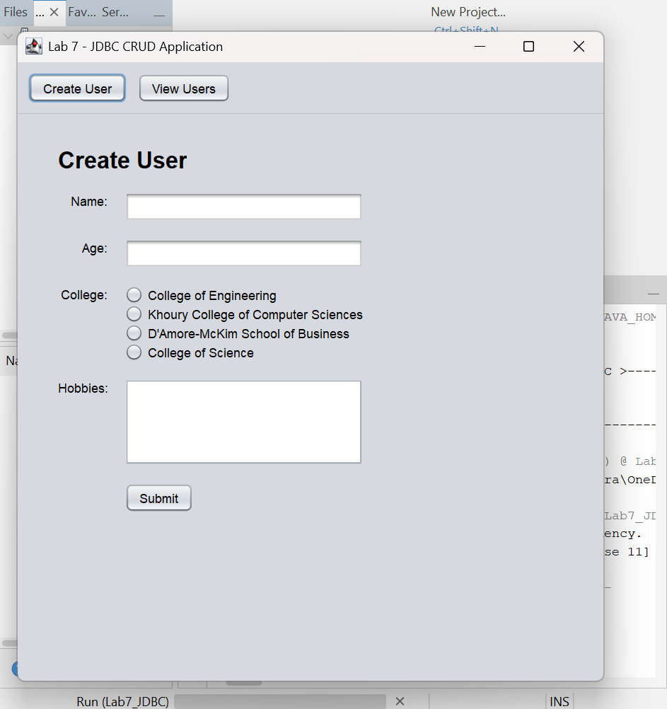
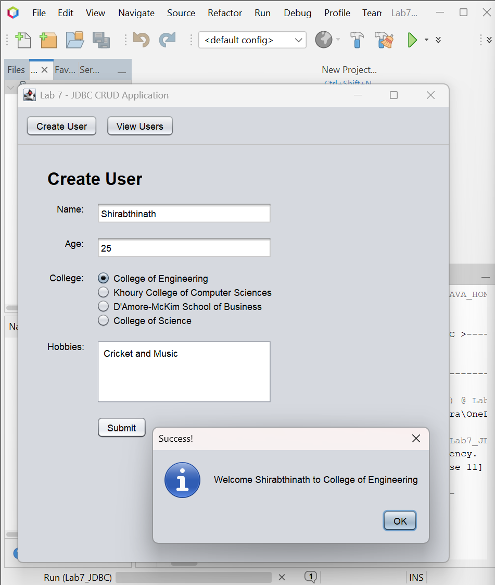
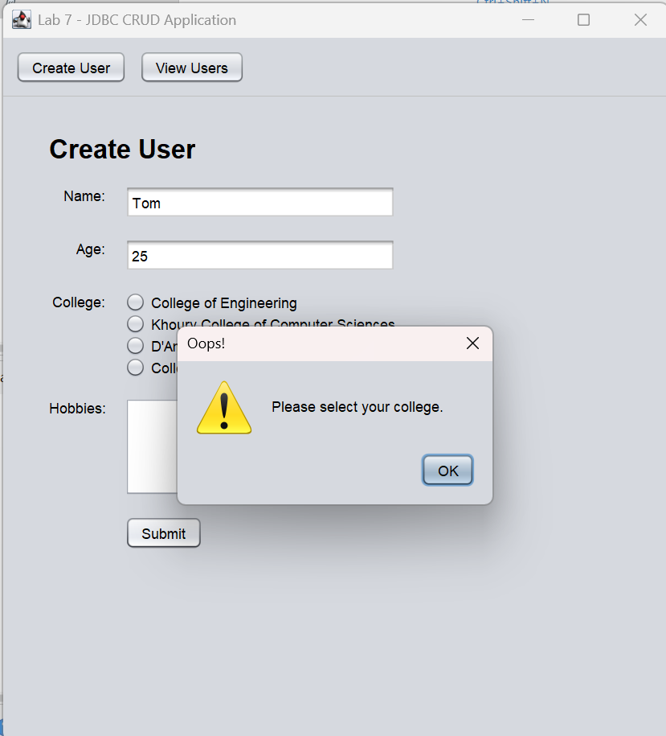
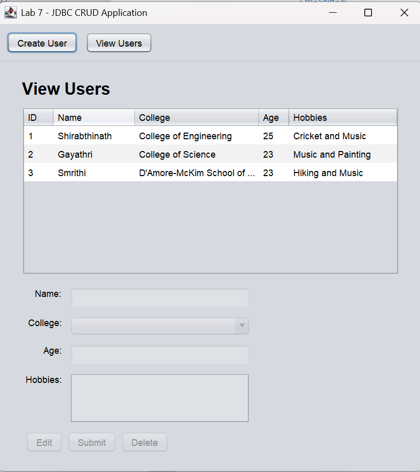
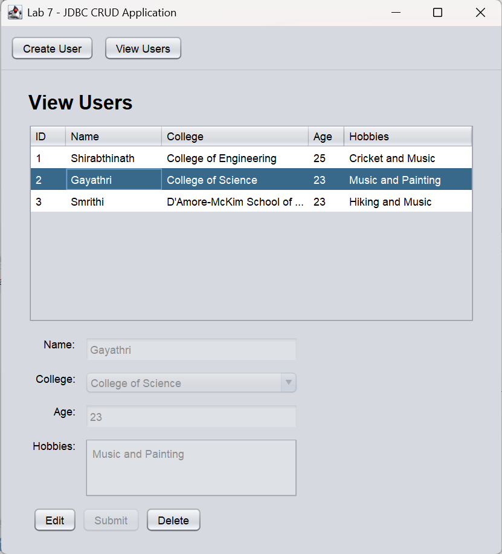
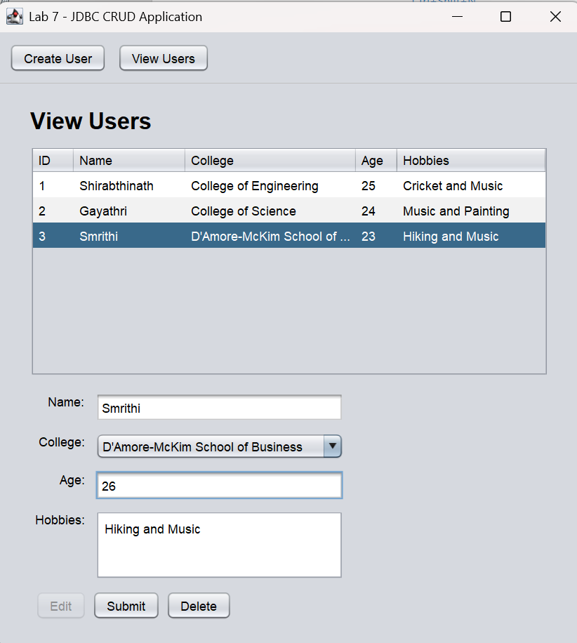
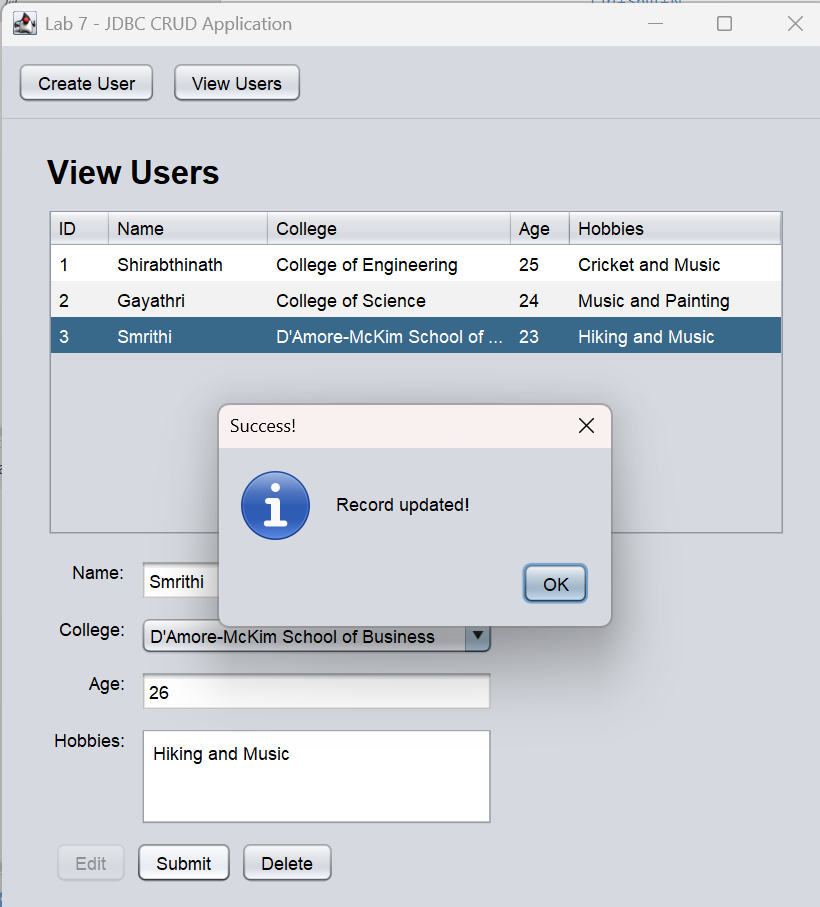
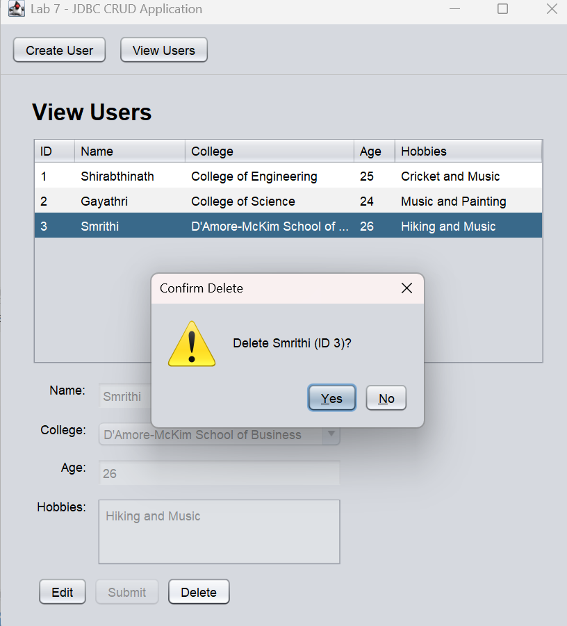
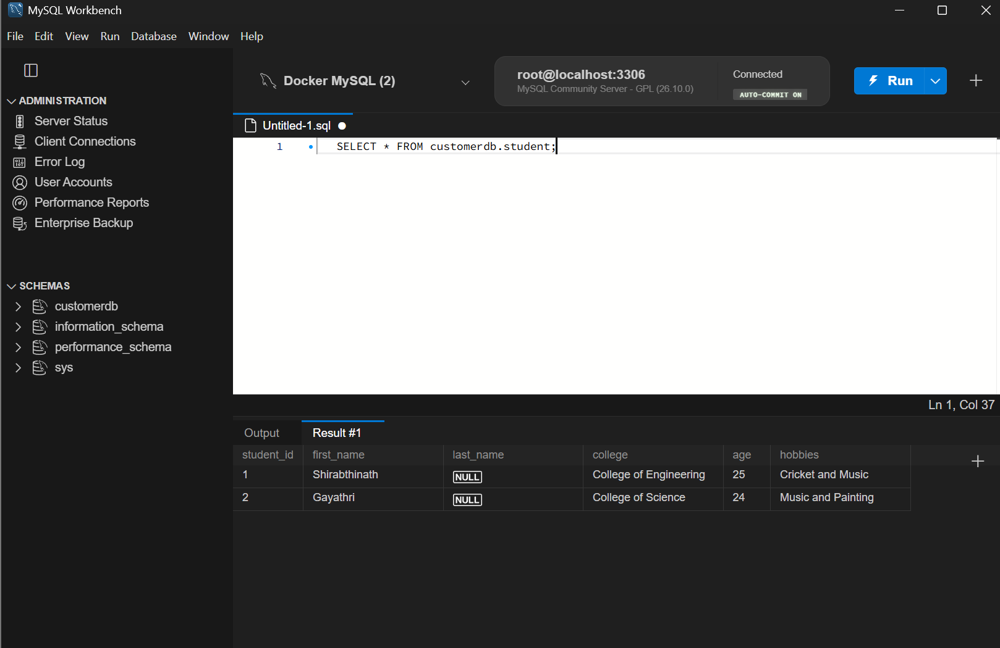

# Lab 7 – Database Connection with JDBC in Java Swing

**Author:** Shirabthinath Shivaji · **Course:** INFO 5100

A Java Swing CRUD application that stores users (students) in a MySQL database using JDBC and the MySQL Connector/J driver. It has two views, a **create form** and a **view form** with a `JTable`, and supports Create, Read, Update and Delete.

## Deliverables

| Requirement | Where |
|---|---|
| Swing app connected to MySQL with JDBC | [`utility/DatabaseConnector.java`](src/main/java/utility/DatabaseConnector.java) |
| Create form | [`ui/FormJPanel.java`](src/main/java/ui/FormJPanel.java) |
| View form with **JTable** (updates on row selection) | [`ui/ViewJPanel.java`](src/main/java/ui/ViewJPanel.java) |
| SQL queries | [`DatabaseQueries.sql`](DatabaseQueries.sql) |
| Screenshots of the running application | [`screenshots/`](screenshots) |

## CRUD Operations

| Operation | Screen | Method in `DatabaseConnector` | SQL |
|---|---|---|---|
| **Create** | FormJPanel → Submit | `addUser(User)` | `INSERT INTO student ...` |
| **Read** | ViewJPanel (on open) | `getUsers()` | `SELECT * FROM student` |
| **Update** | ViewJPanel → Edit → Submit | `updateUser(oldUser, updatedUser)` | `UPDATE student SET ... WHERE student_id = ?` |
| **Delete** | ViewJPanel → Delete | `deleteUser(User)` | `DELETE FROM student WHERE student_id = ?` |

- Selecting a row in the `JTable` shows that user's details in the fields below (disabled). **Edit** enables the fields and **Submit** saves the changes.
- The create form validates the name, age and college and shows an error popup ("Oops!") for invalid input.
- All queries use `PreparedStatement`, and connections are closed with try-with-resources.

## Project Structure

```
Lab7_JDBC/
├── pom.xml                        Maven build (includes mysql-connector-j)
├── DatabaseQueries.sql            Database, table and CRUD queries
├── screenshots/                   Screenshots of the running application
└── src/main/java/
    ├── model/User.java            User data class
    ├── utility/DatabaseConnector.java   JDBC connection and CRUD methods
    ├── utility/UserValidator.java Input validation rules
    └── ui/
        ├── MainJFrame.java        Main window (top navigation + bottom CardLayout panel)
        ├── FormJPanel.java        Create form
        ├── ViewJPanel.java        View / edit / delete form with JTable
        └── Colleges.java          College options
```

## How to Run

1. **Start MySQL** (the Docker container from Lab 6):
   ```bash
   docker start mysql-db
   ```
2. Make sure `DB_URL`, `DB_USERNAME` and `DB_PASSWORD` in `DatabaseConnector.java` match your MySQL server.
3. Open the project in NetBeans (**File → Open Project**). Maven downloads the MySQL connector automatically.
4. Right-click the project → **Run**.

The `customerdb` database and `student` table are created automatically on the first run.

## Screenshots

| Screen | Screenshot |
|---|---|
| Create form |  |
| User added |  |
| Validation error |  |
| View form with JTable |  |
| Row selected |  |
| Editing a record |  |
| Record updated |  |
| Delete |  |
| Data in MySQL Workbench |  |
