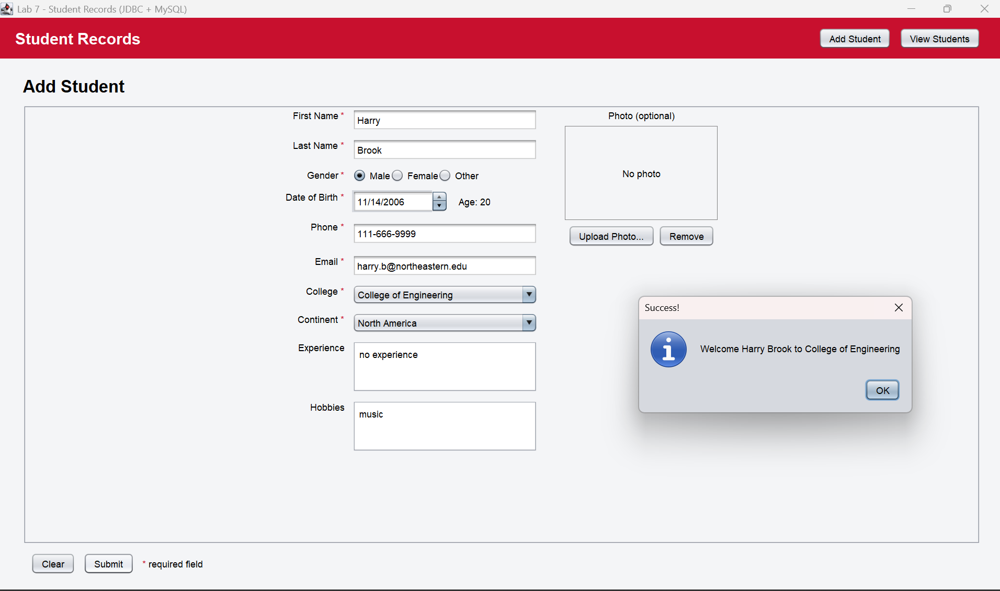
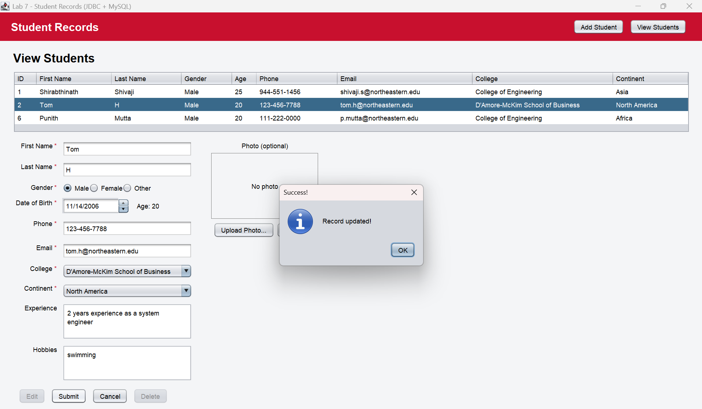
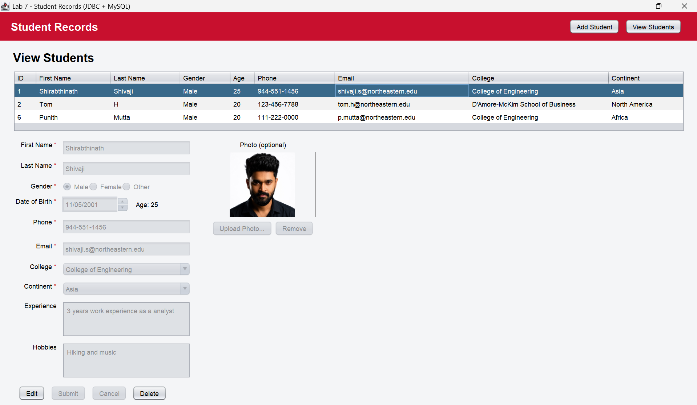
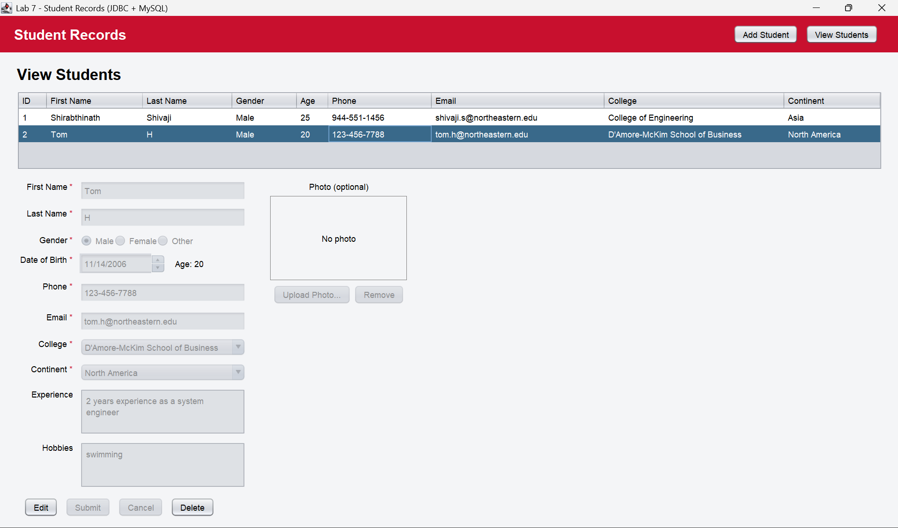
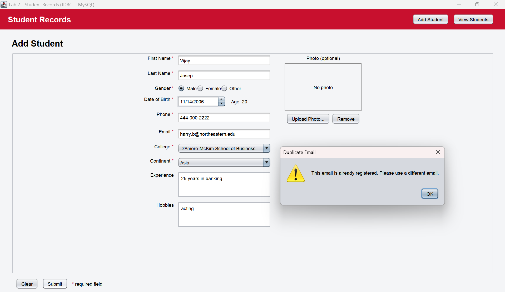
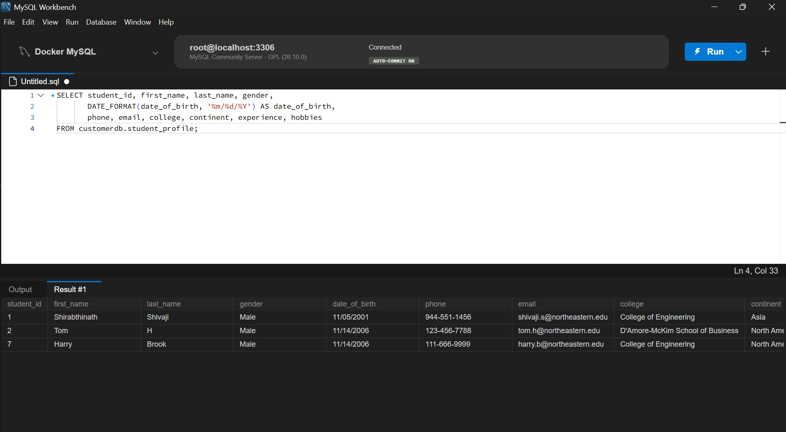

# Lab 7 – Database Connection with JDBC in Java Swing

**Author:** Shirabthinath Shivaji · **Course:** INFO 5100 – Application Engineering & Development

A Java Swing **Student Records** application that stores student profiles in a MySQL database using JDBC (MySQL Connector/J). It has a **create form** and a **view form** with a `JTable`, and supports Create, Read, Update and Delete.

## Lab Requirements

| Requirement | Where |
|---|---|
| Java Swing app connected to MySQL with JDBC | [`utility/DatabaseConnector.java`](src/main/java/utility/DatabaseConnector.java) |
| CRUD actions | `addUser`, `getUsers`, `updateUser`, `deleteUser` in `DatabaseConnector` |
| Create form (view 1) | [`ui/FormJPanel.java`](src/main/java/ui/FormJPanel.java) |
| View form with **JTable** (view 2), updating on row selection | [`ui/ViewJPanel.java`](src/main/java/ui/ViewJPanel.java) |
| SQL queries | [`DatabaseQueries.sql`](DatabaseQueries.sql) |
| Screenshots folder in the repo | [`screenshots/`](screenshots) |

## Features

| Operation | Screen | SQL |
|---|---|---|
| **Create** | Add Student → Submit | `INSERT INTO student_profile ...` |
| **Read** | View Students (loads on open) | `SELECT * FROM student_profile` |
| **Update** | Select a row → Edit → Submit | `UPDATE student_profile SET ... WHERE student_id = ?` |
| **Delete** | Select a row → Delete → Yes | `DELETE FROM student_profile WHERE student_id = ?` |

- **Student profile:** first and last name, gender, date of birth, age, phone, email, college, continent, experience, hobbies and an optional photo.
- **Age is calculated** from the date of birth instead of being stored, so it is always correct.
- **Photo upload** with a preview; the photo also appears in the "Success!" popup.
- **Validation** with a clear "Oops!" message: names (letters only), date of birth (age 16–100, not in the future), phone (10 digits, saved as `123-456-7890`), email format, and required gender and college.
- **Duplicate email check:** `email` is `UNIQUE` in the database, and the app explains the problem instead of crashing.
- **Safe editing:** selecting a row shows the details read-only; **Edit** unlocks them, **Cancel** discards changes, and the table is locked while editing.
- All queries use `PreparedStatement` (no SQL injection) and try-with-resources (connections always closed).

## Project Structure

```
Lab7_JDBC/
├── pom.xml                               Maven build (includes mysql-connector-j)
├── DatabaseQueries.sql                   Database, table and CRUD queries
├── screenshots/                          Screenshots of the running application
└── src/main/java/
    ├── model/User.java                   Student data class (age calculated from date of birth)
    ├── utility/DatabaseConnector.java    JDBC connection and CRUD methods
    ├── utility/UserValidator.java        Validation rules
    └── ui/
        ├── MainJFrame.java               Main window: header + CardLayout bottom panel
        ├── FormJPanel.java               Create form
        ├── ViewJPanel.java               View form with JTable, Edit / Submit / Cancel / Delete
        ├── StudentDetailsPanel.java      Input fields shared by both forms
        ├── Colleges.java                 College options
        ├── Continents.java               Continent options
        └── Theme.java                    Shared colours and fonts
```

## How to Run

1. **Start MySQL** (Docker container from Lab 6): `docker start mysql-db`
2. Check `DB_URL`, `DB_USERNAME` and `DB_PASSWORD` in `DatabaseConnector.java` match your server.
3. Open the project in NetBeans (**File → Open Project**); Maven downloads the MySQL connector.
4. Right-click the project → **Run**.

The `customerdb` database and `student_profile` table are created automatically on the first run.

## Screenshots

### Create user


### Update user


### View users (JTable)
Three students loaded from MySQL, including **Punith Mutta (ID 6)**. Selecting a row shows the full profile below the table.



### Delete user
Student **Punith Mutta (ID 6)** was selected and deleted; the table below was reloaded from the database and no longer contains that row.



### Duplicate email check


### Data in MySQL Workbench

